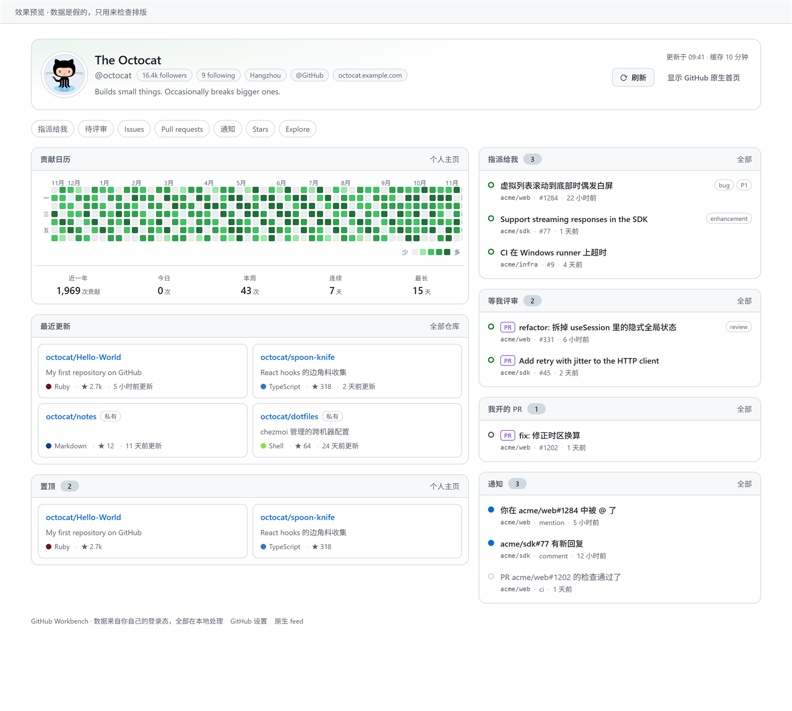

# GitHub Workbench

把 `github.com` 首页换成一块真正能干活的个人工作台：贡献日历、指派给你的 issue、等你评审的 PR、未读通知、最近更新的仓库。

> 现状是首页越来越像内容流（For you / 推荐 / AI 摘要），想看的东西永远要点三层。
> 社区的旧方案（`old-github-feed`、`bring-github-old-feed-back` 之类）都是给原生 feed 打补丁，
> GitHub 2025-09 那次改版基本把它们全废了。
>
> 这个扩展换了个思路：**不修补原页面，直接接管首页**。数据自己抓、界面自己画。



## 特点

- **零配置**。不需要 Personal Access Token，直接用你浏览器里已有的 GitHub 登录态发同源请求。
- **不依赖 class 名**。解析靠「链接形状 + 相对时间」这类结构性特征，GitHub 换 React 组件也大概率还能跑。
- **不联网到第三方**。所有请求都发往 `github.com`，数据只存在本地 `chrome.storage`。
- **跟着主题走**。所有颜色都用 GitHub 自己的 CSS 变量，浅色 / 暗色 / 第三方主题自动适配。
- **可逆**。顶部右侧有「显示 GitHub 原生首页」按钮，随时切回去，不用卸载扩展。

## 面板

| 面板 | 数据来源 |
| --- | --- |
| 贡献日历 + 统计 | `/users/<you>/contributions` |
| 指派给我 | `/issues/assigned` |
| 等我评审 | `/pulls/review-requested` |
| 我开的 PR | `/pulls` |
| 通知 | `/notifications` |
| 最近更新 | `/<you>?tab=repositories&sort=updated` |
| 置顶 / 个人信息 | `/<you>` |

贡献日历不是截图式的装饰：它从页面的 `<tool-tip>` 里读回每天的精确次数，所以「今日 / 本周 / 连续 / 最长」都是算出来的，不是猜的。

## 安装

Chrome / Edge：

1. 打开 `chrome://extensions`（Edge 是 `edge://extensions`）
2. 打开右上角「开发者模式」
3. 「加载已解压的扩展程序」→ 选这个仓库的根目录
4. 打开 https://github.com/ ，已经登录的话会直接看到工作台

改完代码后回到扩展页点一下刷新图标即可，不需要构建，没有打包步骤。

## 设置

点扩展图标：

- 总开关、是否接管首页
- 每个面板单独开关
- 缓存有效期（2 分钟 ~ 1 小时）、列表条数
- 清缓存

## 工作原理

```
github.com 首页加载
   │
   ├─ index.js   判断路由（只接管 / 和 /dashboard），挂载 #ghw-root
   │             并给 <html> 加 ghw-native-hidden，把原生的 main 隐藏掉
   │
   ├─ api.js     同源 fetch 上面那几个页面（带 cookie），带 TTL 缓存
   │             某个源失败不影响其它面板，失败时优先用旧缓存
   │
   ├─ parse.js   DOMParser 解析 HTML：
   │             贡献日历 → td[data-date] + tool-tip
   │             issue 列表 → 反查 /owner/repo/(issues|pull)/123 形式的链接
   │             仓库列表 → li[itemprop="owns"]
   │
   └─ ui.js      纯 DOM 构造渲染（一律 textContent，不拼 innerHTML）
```

为什么不用 `api.github.com`：浏览器里没有 token 时只有 60 次/小时，而且它是跨域，拿不到 cookie 登录态。同源抓页面反而是零配置下最稳的路子。

## 目录

```
manifest.json            MV3 清单
src/core/util.js         DOM helper、数字/时间格式化
src/core/store.js        设置 + 缓存（chrome.storage.local）
src/core/parse.js        HTML → 结构化数据（所有兜底逻辑都在这）
src/core/api.js          同源抓取 + 缓存策略
src/content/ui.js        工作台渲染
src/content/index.js     路由监听、挂载/卸载、生命周期
src/content/styles.css   样式（走 GitHub 的 CSS 变量）
src/popup/*              设置弹窗
preview/demo.html        纯前端预览，假数据，不装扩展也能看效果
tests/                   jsdom 回归测试
```

看效果不用装扩展：

```powershell
start preview\demo.html          # 浅色
start "preview\demo.html?dark"   # 暗色
```

## 测试

```powershell
cd tests
npm install
npm test
```

跑的是两件事：

- `parse.test.mjs`：拿真实抓下来的 contributions / repositories 页面 + 手写的 issue、通知 fixture，验证解析和统计。
- `ui.test.mjs`：在 jsdom 里把所有面板渲染一遍，确认不炸、条目数对、用户可控文本不会被当 HTML 执行。

## 当 GitHub 又改版了

解析层刻意写成「主选择器 + 启发式兜底」，所以大部分改版不会直接挂。如果某个面板空了：

1. 打开对应页面（比如 `/issues/assigned`），看 DOM 结构变了多少；
2. 改 `src/core/parse.js` 里对应的一个函数；
3. 往 `tests/fixtures/` 丢一份新页面，加几条断言，跑 `npm test`。

数据源全在 `src/core/api.js` 的 `SOURCES` 表里，加一个源 = 加一个函数 + 一个面板。

## 已知限制

- 只用 GitHub 的**网页结构**，不是官方 API，所以有改版风险（上面写了怎么修）。
- 首页之外的页面什么都不做，不会注入任何 UI。
- 每次刷新首页最多发 7 个同源请求（都有缓存，默认 10 分钟）。嫌多可以把面板关掉，关掉的面板不会发请求。
- 企业版 / GitHub Enterprise 的自托管域名没有适配（改 `manifest.json` 的 `matches` 即可）。

## Roadmap

- [ ] 命令面板：`Ctrl/Cmd + K` 搜仓库、issue、PR
- [ ] 可选 PAT 模式：用 `api.github.com` 拿到更精确的数据（评审状态、CI 结论）
- [ ] 列表项显示的字段可配置（标签 / 时间 / 状态）
- [ ] 快捷键在原生页面和工作台之间来回切

## License

MIT
